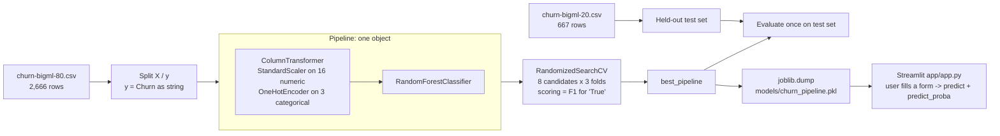

# Interview Study Guide: Customer Churn Prediction

This guide helps you explain and defend this project in an interview. It is written for a beginner. Every term is explained the first time it appears. Every number here comes from the notebook output or from re-running the saved model on the repo's data. Nothing is made up. If an interviewer asks for a number that is not in this guide, say "I didn't measure that", and say how you would measure it.

Files referenced:
- `notebook/Customer_Churn_Prediction_System_Modified_Final.ipynb` (cited below as "cell N", counting cells from 0)
- `app/app.py` (cited as `app.py:line`)
- `data/churn-bigml-80.csv`, `data/churn-bigml-20.csv`, `data/data_dictionary.md`

---

## 1. The 30-second explanation

> "I built a machine-learning model that predicts which telecom customers are likely to cancel their service, which is called churn. I used the public BigML telecom dataset of 3,333 customers. I trained a Random Forest inside a scikit-learn Pipeline, so the preprocessing is saved together with the model, and I serve it through a Streamlit web app. On a held-out test set it gets 0.94 accuracy. Accuracy is misleading here, though, because only about 14% of customers churn. The numbers that matter are these: when it flags someone, it is right 97% of the time, but it only catches 61% of the real churners. Improving that recall is the next step."

## 2. The 60-second explanation

> "Keeping a customer is usually cheaper than winning a new one, so a telecom company wants to find customers at risk early and offer them something to stay. I used a public dataset of 3,333 US telecom customers with 19 features: their state, their plans, call minutes and charges, and how many times they called customer service. It came already split into 2,666 training rows and 667 test rows.
>
> I built a scikit-learn Pipeline. A ColumnTransformer scales the 16 numeric columns and one-hot encodes the 3 text columns, and a Random Forest classifier comes after it. I tuned it with RandomizedSearchCV, using 3-fold cross-validation to optimise F1 for the churn class.
>
> On the 667 test customers: accuracy 0.94, churn precision 0.97, recall 0.61, F1 0.75, ROC-AUC 0.93. The confusion matrix shows 58 churners caught and 37 missed, with only 2 false alarms.
>
> While reviewing it, I found two evaluation bugs. The ROC code looked for the label 'Yes' when the labels are 'True' and 'False'. And the F1 scorer silently failed on string labels, so the tuning was effectively blind. I fixed both. The results barely changed, which told me the real weakness is recall, not tuning. The fix for that is to lower the decision threshold or use class weights."

---

## 3. Business problem and why it matters

- **Churn** means a customer stops using the service (cancels).
- **Why predict it:** if you know who is likely to leave, the retention team can call them, offer a discount, or suggest a better plan before they go.
- **What a mistake costs (this decides which metric matters):**
  - **False negative** (missed churner): the customer leaves and you never tried to keep them. You lose all their future revenue.
  - **False positive** (false alarm): you offer a discount to someone who was going to stay anyway. You lose the cost of the offer.
  - In most churn cases a missed churner costs more than a wasted offer. That is why **recall** (how many churners we catch) matters a lot here. The project does not include real cost figures. If asked, say you would get them from the business before choosing a threshold.

---

## 4. Architecture and data flow



In plain English:
1. Load two CSV files: one for training and one for testing (cell 3).
2. Separate the features (inputs) from the target (`Churn`) (cells 8 and 12).
3. Build one Pipeline object that does the preprocessing and the model together (cell 10).
4. Try 8 combinations of model settings using cross-validation, and keep the best one (cell 14).
5. Score the best pipeline once on the test set (cell 16).
6. Save the pipeline to a `.pkl` file (cell 18). The Streamlit app loads that file and makes predictions from a form (`app.py:16`, `app.py:63-64`).

---

## 5. Dataset schema and data-quality checks

**Source:** BigML Telecom Churn, public. 3,333 customers in total, already split 80/20 into two files.

| Group | Columns | Type in code |
|---|---|---|
| Customer info | `State` (51 values), `Area code` (only 3 values: 408, 415, 510) | `State` is text; `Area code` is read as a number |
| Plans | `International plan`, `Voice mail plan` (Yes/No) | text |
| Usage | day / eve / night / intl minutes, calls, charge (12 columns), `Number vmail messages` | numeric |
| Tenure | `Account length` (days) | numeric |
| Support | `Customer service calls` | numeric |
| Target | `Churn` (True/False) | converted to the strings `'True'` / `'False'` (cell 12) |

There are 19 features: 16 numeric and 3 categorical (cell 8 output). The data dictionary lists a `Phone` column, but these CSV files do not contain it. The drop step in cell 7 therefore does nothing, which is harmless.

**Data-quality checks (run on the repo's CSVs):**

| Check | Result | Why it matters |
|---|---|---|
| Missing values | 0 | No imputation needed. Still, a real pipeline should handle missing values in case a future file has gaps. |
| Duplicate rows | 0 | Duplicates can leak between train and test. |
| Churn rate, train | 388 / 2,666 = 14.6% | Imbalanced classes |
| Churn rate, test | 95 / 667 = 14.2% | Similar to train, so the split is fair |
| Churn rate, all | 14.5% | |
| Correlation of minutes vs charge (day / eve / night / intl) | 1.0 for all four | The charge is just minutes × rate, so 4 columns are pure duplicates. That doesn't hurt a Random Forest much, but it splits "importance" between the twins and adds no information. |

**Quick EDA findings (verified on all 3,333 rows):**
- Customers with an **international plan** churn at 42.4% (323 customers). Those without one churn at 11.5%.
- **Customer service calls:** with 0 to 3 calls the churn rate is about 10–13%. With 4 calls it jumps to 45.8% (166 customers), and with 5 calls to 60.6% (66 customers). An angry customer who keeps calling support is a strong warning sign.

**Something to own up to:** `Area code` is treated as a number (cell 8 chose types by dtype), but it is really a category. Area code 510 is not "more" than 408. A tree model copes with this, but the correct fix is to add it to `cat_cols`.

---

## 6. Code walkthrough in plain English

### 6.1 Pick column types (cell 8)
```python
cat_cols = [c for c in feature_cols if df_train[c].dtype == 'object' or df_train[c].dtype.name == 'category']
num_cols = [c for c in feature_cols if c not in cat_cols]
```
Text columns are categorical. Everything else is numeric. It is simple, but it is why `Area code` ends up numeric (see above).

### 6.2 Preprocessing plus model in one Pipeline (cell 10)
```python
categorical_transformer = OneHotEncoder(handle_unknown='ignore', sparse_output=False)
preprocessor = ColumnTransformer(transformers=[('num', StandardScaler(), num_cols),
                                               ('cat', categorical_transformer, cat_cols)], remainder='drop')
pipeline = Pipeline([('preproc', preprocessor), ('model', rf)])
```
- **StandardScaler:** rescales each number to mean 0 and standard deviation 1. Random Forests don't need scaling, since trees only compare values against thresholds. It is harmless here, and it means you could swap in Logistic Regression without changing anything else.
- **OneHotEncoder:** turns `State = OH` into 51 columns of 0s and 1s, with a 1 in the `State_OH` column. `handle_unknown='ignore'` means that if the app receives a state code never seen in training (like a typo, `"XX"`), the encoder outputs all zeros instead of crashing.
- **ColumnTransformer:** sends each list of columns to its own transformer and glues the results back together.
- **Pipeline:** chains the steps, so `pipeline.fit(X, y)` and `pipeline.predict(X)` run every step in order.

### 6.3 Tuning with a correct F1 scorer (cell 14)
```python
f1_churn = make_scorer(f1_score, pos_label=sorted(y_train.unique())[-1])   # -> 'True'
rsearch = RandomizedSearchCV(pipeline, param_distributions=param_dist, n_iter=8, cv=3,
                             scoring=f1_churn, n_jobs=-1, random_state=RANDOM_STATE)
```
- The search space is `n_estimators` ∈ {100, 200, 300}, `max_depth` ∈ {None, 5, 10}, `min_samples_split` ∈ {2, 5}. That is 18 combinations, of which 8 are sampled at random.
- `model__n_estimators` means "the `n_estimators` setting of the step named `model`". The double underscore is how a Pipeline routes settings to its steps.
- **Best parameters:** `n_estimators=300, min_samples_split=5, max_depth=None` (cell 14 output).
- `sorted(['False','True'])[-1]` is `'True'`. It works, but writing `pos_label='True'` would be clearer.

### 6.4 Evaluation (cell 16)
```python
pos_label = classes[1] if classes is not None else True     # classes = ['False', 'True']
y_test_bin = (y_test == pos_label).astype(int)
y_score = y_proba[:, 1]
```
`predict_proba` returns one column per class, in the order of `model.classes_`. Here that order is `['False', 'True']`, so column 1 is P(churn). Use `classes_` to find the right column rather than guessing.

### 6.5 Saving (cell 18)
`joblib.dump(best_pipeline, 'models/churn_pipeline.pkl')` saves the fitted encoder, the scaler and the forest together.

### 6.6 The app (`app/app.py`)
- `app.py:16`: `pipeline = joblib.load(pipeline_path)` loads the whole pipeline.
- `app.py:34-54`: builds one form input per feature. Numeric features get a `number_input` that defaults to 0.0. Plans get Yes/No dropdowns. State is a text box.
- `app.py:60`: `pd.DataFrame([user_input], columns=feature_cols)` puts the columns in the same order as in training.
- `app.py:63-64`: `predict` gives the label (`'True'`/`'False'`), and `predict_proba(...)[0][1]` gives the churn probability.
- Weak spots you should know about:
  - `models_dir = Path("models")` is relative, so you must run the app from the repo root.
  - There is a bare `except:` at `app.py:42`.
  - Every number defaults to 0, which is not a realistic customer.
  - The app shows the raw label "True" instead of "Likely to churn".

---

## 7. The bug-fix story (tell this one, interviewers love it)

**Bug 1: ROC-AUC was NaN.**
The ROC code compared the labels to `'Yes'`, but after `astype(str)` the labels are `'True'`/`'False'`. So `y_test == 'Yes'` was all False, meaning there were zero positives, and ROC-AUC came out as NaN (not a number).
*Fix:* take the positive label from `model.classes_[1]`.
*Lesson:* check your label values (`y.unique()`) before writing any metric code.

**Bug 2: the tuning was blind.**
`scoring='f1'` assumes the positive label is `1`. With string labels, scikit-learn cannot compute it, so each fold's score became NaN (the error is caught and turned into a warning, and the notebook hides warnings with `warnings.filterwarnings('ignore')` in cell 1). Every candidate tied at NaN, so the search picked one essentially without real information.
*Fix:* `make_scorer(f1_score, pos_label='True')`.
*Lesson:* never silence all warnings, and print `rsearch.cv_results_['mean_test_score']` to confirm the scores are real numbers.

**What happened after the fixes:** the test results barely changed (0.94 / 0.97 / 0.61). That is an honest and useful finding. It means the model's settings were not the problem. The problem is that, at the default 0.5 threshold, the model is too cautious. Recall is the weakness.

How to say it: *"Fixing the evaluation bugs didn't improve the score. It made the score trustworthy. And a trustworthy score showed me exactly where the weakness is: recall."*

---

## 8. Metrics and KPIs: formulas and what the actual numbers mean

Confusion matrix from cell 16. Rows are actual, columns are predicted, and the order is False, True:

```
                 predicted stay   predicted churn
actual stay          570 (TN)          2 (FP)
actual churn          37 (FN)         58 (TP)
```

| Metric | Formula | Value | Plain-English meaning |
|---|---|---|---|
| Accuracy | (TP+TN)/all = (58+570)/667 | 0.94 | 94% of all predictions are correct. Misleading here; see below. |
| Precision (churn) | TP/(TP+FP) = 58/60 | 0.97 | When the model says "will churn", it is right 97% of the time. |
| Recall (churn) | TP/(TP+FN) = 58/95 | 0.61 | Of the real churners, the model catches 61%. It misses 37. |
| F1 (churn) | 2·P·R/(P+R) | 0.75 | One number that balances precision and recall (the harmonic mean). |
| ROC-AUC | area under the TPR-vs-FPR curve | 0.929 | Pick a random churner and a random non-churner: 92.9% of the time the model gives the churner a higher score. |
| PR-AUC (average precision) | area under the precision-recall curve | 0.874 | Like ROC-AUC, but focused on the rare class. For comparison, a random model's PR-AUC would be about 0.14 (the churn rate). |

**Why accuracy is misleading.** 572 of the 667 test customers did not churn. A useless model that always says "no churn" would score 572/667 = **85.8% accuracy** while catching **zero** churners. Our 94% is only about 8 points better than doing nothing. Always compare against this "majority-class baseline".

**Precision vs recall and the threshold.** By default the model says "churn" when P(churn) ≥ 0.5. Lowering that cut-off flags more people: recall goes up and precision goes down. I re-ran the saved pipeline on the test set at different thresholds:

| Threshold | Flagged | Churners caught (of 95) | Precision | Recall | F1 |
|---|---|---|---|---|---|
| 0.5 (default) | 60 | 58 | 0.967 | 0.611 | 0.748 |
| 0.4 | 80 | 73 | 0.912 | 0.768 | 0.834 |
| 0.3 | 99 | 79 | 0.798 | 0.832 | 0.814 |
| 0.2 | 135 | 83 | 0.615 | 0.874 | 0.722 |

**Important caveat (say this before the interviewer does):** these thresholds were scored on the **test set**, so choosing the "best" one from this table would be cheating (that is leakage: using test data to make a modelling decision). The right way is to pick the threshold using cross-validated predictions on the training data (for example `cross_val_predict(..., method='predict_proba')`), or a separate validation split. Then you report the test score once. The table only shows the shape of the trade-off.

---

## 9. Key concepts explained

**Pipeline and ColumnTransformer prevent leakage and train/serve skew.**
- *Leakage* means information from data the model shouldn't see sneaks into training. Example: if you fit the scaler on all 3,333 rows before splitting, the scaler's mean "knows" about the test rows. Inside a Pipeline, during cross-validation the scaler and encoder are re-fitted on each training fold only, so the held-out fold stays truly unseen.
- *Train/serve skew* means the app transforms the input differently from how training did (a different column order, a forgotten encoding step, different one-hot columns). Saving the whole pipeline means the app runs exactly the same steps. That's why `app.py` needs only one line, `pipeline.predict(X_input)`.

**One-hot vs label encoding.**
- Label encoding maps OH=0, KS=1, NJ=2, and so on. That invents a fake order (NJ > OH?), which linear models will misread.
- One-hot encoding creates one 0/1 column per value, with no fake order. The cost is more columns (State becomes 51). Trees can sometimes live with label encoding, but one-hot is the safe default for unordered categories.

**Random Forest intuition.**
- A decision tree asks yes/no questions, for example "more than 3 customer service calls?" then "international plan = Yes?" and so on until it reaches a leaf.
- One deep tree memorises the training data (overfitting).
- A Random Forest builds many trees (300 here). Each tree sees a random sample of the rows (bootstrap sampling) and random subsets of the features at each split. The forest then averages their votes. Averaging many slightly different trees cancels out their individual mistakes.
- `predict_proba` is roughly the share of trees voting "churn".
- `max_depth=None` lets the trees grow fully. `min_samples_split=5` stops a node from splitting if it has fewer than 5 rows, which is a mild brake on overfitting.

**Cross-validation (CV).** With `cv=3`, the training data is cut into 3 parts. The model trains on 2 parts and scores on the 3rd, three times over, and the 3 scores are averaged. This picks settings without touching the test set. Here that meant 8 candidates × 3 folds = 24 fits (cell 14 output). Note: for classification, scikit-learn's default `cv=3` uses *stratified* folds, so each fold keeps about 14% churners.

**class_weight.** `RandomForestClassifier(class_weight='balanced')` makes each churner count about 6 times more than a non-churner during training (roughly 2,278/388). The model then pays more attention to the rare class, which usually raises recall. This project has **not** tried it yet. It is listed as a next step in the README, so don't claim results for it.

---

## 10. Why each technology was chosen

| Tech | Why | Honest alternative |
|---|---|---|
| pandas | Load and inspect CSVs | Polars, for big data |
| scikit-learn Pipeline / ColumnTransformer | Bundles preprocessing with the model and prevents leakage | Manual steps (error-prone) |
| Random Forest | Strong default on tabular data, handles non-linear patterns, needs little tuning, gives feature importances | Logistic Regression (simpler, explainable), Gradient Boosting / XGBoost (often more accurate) |
| RandomizedSearchCV | Tries a sample of settings, so it's cheaper than trying every combination | GridSearchCV (tries all 18 here) |
| joblib | Saves scikit-learn objects efficiently | pickle, skops (safer format) |
| Streamlit | A web UI in pure Python, quick to demo | Flask/FastAPI + HTML |

Pinned versions (`requirements.txt`): pandas 2.2.3, scikit-learn 1.5.2. Pinning matters because a pickle saved with one scikit-learn version may not load correctly in another.

---

## 11. Testing and validation (what exists, and what doesn't)

What exists:
- A held-out test set, used once at the end.
- 3-fold cross-validation during tuning.
- Multiple metrics, including PR-AUC for the rare class.
- After the fix, a manual check that `classes_` is `['False','True']`.

What does **not** exist (say so if asked):
- No unit tests (`pytest`) for the app or the pipeline.
- No check that the CV scores are not NaN.
- No calibration check (does a "70%" really mean 70%?).
- No monitoring of data drift.

What you would add:
1. A test that loads `churn_pipeline.pkl`, predicts on 5 known rows, and asserts the output shape and that the probabilities fall in [0, 1].
2. An assertion that `np.isfinite(rsearch.cv_results_['mean_test_score']).all()`.
3. A test that the app's feature list equals `feature_cols.pkl`.

---

## 12. Limitations and ethical considerations

- **Recall is 0.61.** About 4 in 10 churners are missed at the default threshold.
- **Small, old, public dataset** (3,333 rows from one US telecom). It may not transfer to another company or country.
- **Redundant features** (charge = minutes × rate) and `Area code` treated as a number.
- **No explainability yet** (feature importance or SHAP). A retention agent wants to know *why* a customer was flagged.
- **Evaluation leakage risk** if you tune the threshold on the test set (see section 8).
- **The app's defaults** (all zeros) do not describe a realistic customer.
- **Ethics:**
  - *Fairness:* `State` is a feature. If retention offers are only sent to flagged customers, people in some states could systematically get fewer or more discounts. Check the error rates per group before deploying.
  - *Privacy:* real churn data contains personal usage records. Use only what's needed, and don't include phone numbers (this dataset doesn't).
  - *Use of predictions:* use them to *help* customers (better plans), not to manipulate them or make cancelling harder.

---

## 13. Interview questions with model answers and follow-ups

**Q1. Walk me through your project.**
A: Use the 60-second answer (section 2).
*Follow-up:* "What would you do next?" → Pick a threshold using CV probabilities, try `class_weight='balanced'`, compare against Logistic Regression and Gradient Boosting, and add SHAP explanations.

**Q2. Your accuracy is 94%. Is that good?**
A: Not by itself. Only 14.2% of test customers churn, so always predicting "no churn" already gets 85.8%. The real story is recall of 0.61 and precision of 0.97.
*Follow-up:* "Which metric would you report to a manager?" → Recall at an agreed precision, for example "we catch X% of leavers, and Y% of the people we call really were at risk", plus the number of customers flagged per month.

**Q3. Explain precision and recall to a non-technical person.**
A: Precision: of the people we warned about, how many really left. Recall: of the people who really left, how many we warned about. Ours: 58 of 60 warnings were right (precision), but we only warned about 58 of 95 leavers (recall).
*Follow-up:* "Which matters more here?" → Usually recall, because losing a customer costs more than a discount. But it depends on the real costs, which I'd get from the business.

**Q4. How would you increase recall?**
A: Lower the decision threshold below 0.5, use `class_weight='balanced'`, or try resampling (SMOTE/undersampling, applied only to training folds). On the saved model, a threshold of 0.4 gave recall 0.77 with precision 0.91 on the test set. I would choose the threshold with cross-validation, not on the test set.
*Follow-up:* "Why not choose it on the test set?" → Then the test score is no longer an honest estimate. You have tuned to it.

**Q5. What is ROC-AUC, and what does 0.929 mean?**
A: It's the probability that a random churner gets a higher score than a random non-churner. 0.5 is a coin flip and 1.0 is perfect. It doesn't depend on the threshold.
*Follow-up:* "Why also report PR-AUC?" → ROC-AUC can look good on imbalanced data because there are so many true negatives. PR-AUC focuses on the rare class. Ours is 0.874, against a baseline of about 0.14.

**Q6. Tell me about a bug you found.**
A: The bug-fix story in section 7: the 'Yes' label bug made ROC NaN, and `scoring='f1'` silently failed on string labels, making the tuning blind. I fixed both with `classes_[1]` and `make_scorer(f1_score, pos_label='True')`.
*Follow-up:* "How would you stop that happening again?" → Don't suppress all warnings, assert that the CV scores are finite, convert labels to 0/1 early, and add a unit test for the metric code.

**Q7. Why use a Pipeline?**
A: It keeps preprocessing and model together. In CV it re-fits the scaler and encoder on each training fold only, so there's no leakage. In the app the exact same transforms run, so there's no train/serve skew.
*Follow-up:* "Give a leakage example." → Fitting StandardScaler on train+test before splitting. The scaler's mean then includes test data.

**Q8. One-hot vs label encoding: which did you use, and why?**
A: One-hot, with `handle_unknown='ignore'`. States have no natural order, and label encoding would invent one.
*Follow-up:* "What's the downside?" → More columns (51 for State). With very many categories you might use target encoding (done inside CV) or frequency encoding.

**Q9. How does a Random Forest work?**
A: Many decision trees, each trained on a random sample of rows and choosing among random subsets of features at each split. Their votes are averaged, which reduces overfitting compared with a single tree.
*Follow-up:* "Why does it not need scaling?" → Trees split on thresholds, and rescaling a column doesn't change which threshold separates the data.

**Q10. What hyperparameters did you tune, and what won?**
A: `n_estimators` {100, 200, 300}, `max_depth` {None, 5, 10}, `min_samples_split` {2, 5}, sampling 8 of the 18 combinations with 3-fold CV. The best was 300 trees, no depth limit, min_samples_split 5.
*Follow-up:* "Is 8 iterations enough?" → It's small. With 18 total combinations, GridSearchCV would be cheap enough to try them all.

**Q11. What is cross-validation, and why not just use the test set?**
A: CV rotates which part of the training data is held out, so model choices are made without touching the test set. The test set is then used once, for an honest final score.
*Follow-up:* "What is stratified CV?" → Each fold keeps the same class proportions (about 14% churn), so no fold ends up with almost no churners.

**Q12. Which features matter most?**
A: I didn't compute feature importances in the notebook, so I won't claim a ranking. From the EDA, international-plan holders churn at 42% versus 12%, and customers with 4 or more service calls churn at 46–61%. I would confirm with permutation importance or SHAP.
*Follow-up:* "Why permutation importance over the built-in importance?" → The built-in importance favours high-cardinality features and splits credit between correlated twins like minutes and charge.

**Q13. Did you check data quality?**
A: Yes: no missing values, no duplicates, similar churn rates in train and test (14.6% vs 14.2%). I also found the charge columns are perfectly correlated with the minutes columns, and that `Area code` should be categorical.
*Follow-up:* "What would you do about the correlated columns?" → Drop the charge columns. That won't change accuracy much, but the model is simpler and the importances are cleaner.

**Q14. How is the model served?**
A: A Streamlit app loads `churn_pipeline.pkl`, builds a one-row DataFrame from the form in the training column order, and shows the predicted label and the churn probability.
*Follow-up:* "What breaks in production?" → A different scikit-learn version can't load the pickle reliably. The relative `models/` path. No input validation. The predictions aren't logged. And for batch scoring you would use a scheduled job, not a form.

**Q15. What is `class_weight='balanced'`?**
A: It weights each class inversely to its frequency, so mistakes on the rare churners cost more during training. I haven't tried it in this project yet. It's a next step.
*Follow-up:* "Would it change precision?" → Probably lower it and raise recall. It moves along the same trade-off as lowering the threshold.

**Q16. What if a new state code appears in the app?**
A: `OneHotEncoder(handle_unknown='ignore')` encodes it as all zeros, so the app doesn't crash. The model just has no state information for that row.

**Q17. Is the probability trustworthy? If it says 70%, is it 70%?**
A: Not guaranteed. Random Forest probabilities are often not well calibrated. I'd check with a calibration curve and fix it with `CalibratedClassifierCV` if needed.

**Q18. How would you put a business value on this?**
A: Expected saving = (churners caught × retention success rate × customer value) − (customers contacted × offer cost). I don't have those business numbers, so I would get them from the business and use this formula to choose the threshold.

**Q19. What are the ethical risks?**
A: Using State could treat regions unequally, so I would check error rates per group. Use the data minimally. Use predictions to help customers, not to trap them.

**Q20. What would you do differently if you started again?**
A: Convert the target to 0/1 at the start, never silence warnings, mark Area code as categorical, drop the duplicate charge columns, choose the threshold with CV, add unit tests, and add SHAP explanations.

---

## 14. Common mistakes to avoid in the interview

- Leading with "94% accuracy" without mentioning the 85.8% baseline.
- Claiming results for `class_weight`, SMOTE, XGBoost or SHAP. None of these were done.
- Saying "tuning improved the model". After the fix, results barely changed, so say that instead.
- Choosing a threshold from the test-set table and calling it your final result.
- Saying Random Forest "needs scaling". It doesn't, and you included the scaler for flexibility.
- Calling ROC-AUC "accuracy" or confusing precision with recall. Practise with the 58/60 and 58/95 numbers.
- Forgetting that the labels are the strings `'True'`/`'False'`, which was the root of both bugs.
- Saying "the model found that State causes churn". It finds correlation, not causation.

---

## 15. Practical exercises (do these, they prove you understand)

**Exercise 1: Rebuild the baseline.**
Compute the accuracy of "always predict False" on the test file.
*Hint:* `(y_test == 'False').mean()`.
*Check:* you get 0.8576 (572/667).

**Exercise 2: Recompute the metrics by hand.**
Using only the confusion matrix [[570,2],[37,58]], calculate accuracy, precision, recall and F1 on paper.
*Check:* 0.94, 0.97, 0.61, 0.75.

**Exercise 3: Reproduce the bug.**
In a copy of cell 14, change `scoring=f1_churn` to `scoring='f1'`, remove `warnings.filterwarnings('ignore')`, and print `rsearch.cv_results_['mean_test_score']`.
*Hint:* look for warnings about `pos_label`.
*Check:* the scores are `nan`. Switch back and they become real numbers.

**Exercise 4: Choose a threshold properly.**
Use `cross_val_predict(best_pipeline, X_train, y_train, cv=3, method='predict_proba')[:, 1]` to choose the threshold that maximises F1 on the *training* predictions, then apply it once to the test set.
*Check:* your test recall should be above 0.61. Write down the threshold you picked and explain why it isn't cheating.

**Exercise 5: Try class_weight.**
Add `class_weight='balanced'` to the forest, re-run the search, and compare the test precision and recall with section 8.
*Check:* report what actually happens, even if recall doesn't improve. Honest results are the point.

**Exercise 6: Fix the feature types.**
Move `Area code` into `cat_cols` and drop the 4 `charge` columns, then retrain.
*Check:* the feature count after one-hot changes. The metrics should stay roughly similar, and you can explain why (trees already coped with both issues).

**Exercise 7: Feature importance.**
Run `sklearn.inspection.permutation_importance` on the test set with `scoring` set to your F1 scorer.
*Check:* do `Customer service calls` and `International plan` rank high, as the EDA in section 5 suggests? Explain any surprise.

**Exercise 8: Write one unit test.**
Create `tests/test_pipeline.py`. It should load the pipeline, predict on the first 5 test rows, and assert that the outputs are in `{'True','False'}` and the probabilities are in [0, 1].
*Check:* `pytest -q` passes.
